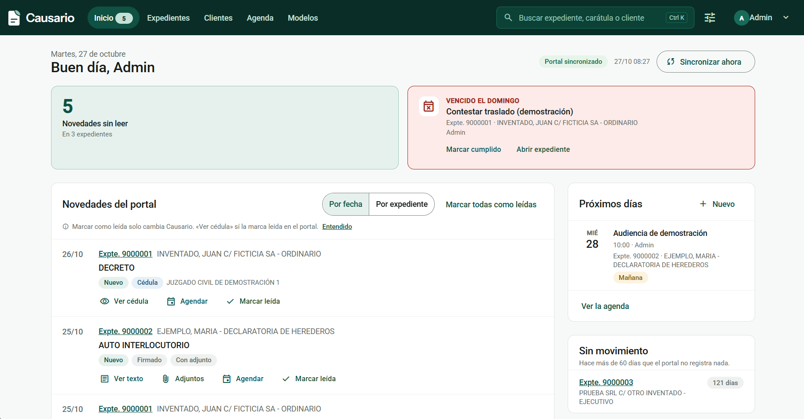
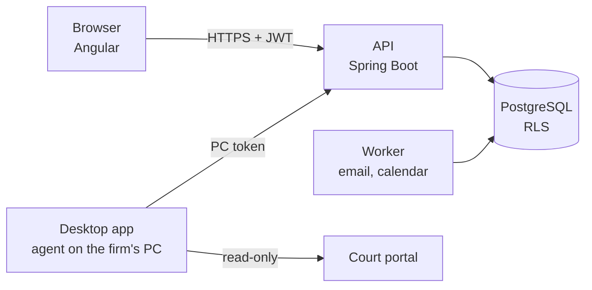

# Causario

Practice management system for small law firms (1 to 5 people) that pulls updates from court portals automatically.

[Versión en español](README.md)

## Links

**[Live demo](https://francoamarilla.github.io/causario-demo/)** · [Contact](#contact)

## The problem

A small firm usually works with Drive folders and Excel sheets. To know whether a case has news, someone must log into the court portal, check each case and open the notifications. Deadlines live in a separate spreadsheet, apart from what happens in the portal. If nobody checks in time, a deadline is missed.

## What it does

| Feature | Benefit |
|---|---|
| Read-only sync with the Córdoba Judiciary portal | New case operations and notifications arrive on their own. |
| Home screen: news, this week's deadlines, idle cases | One screen shows what needs attention today. |
| Agenda of deadlines, hearings and tasks | Deadlines computed in business days using each court's judicial calendar. |
| Daily email digest | Each person gets their own deadlines and case news. |
| Cases, clients and parties | Everything in one place, with case-client links. |
| Case timeline | Portal operations and the firm's internal entries together. |
| Documents and brief templates | Briefs auto-filled with case data, exportable to Word. |
| Per-person permissions | The firm decides who sees everything and who sees only their own work. |

Per-screen detail in [docs/funcionalidades.md](docs/funcionalidades.md) (Spanish).

## Project status

- First commit in the repository: 2026-09-30.
- Pilot in production since 2026-10-13, with 3 people at a law firm in Córdoba, Argentina.
- Córdoba integration works. The PJN (federal courts) integration is on the roadmap and not implemented yet.
- Built solo.

## Stack

| Layer | Technology |
|---|---|
| Backend | Java 21, Spring Boot 3.5, Spring Security + JWT, Spring Data JPA (Hibernate 6) |
| Database | PostgreSQL 16, Flyway migrations, Row Level Security |
| Frontend | Angular 22 (standalone components), Angular Material, TypeScript |
| Portal integration | Java agent; Playwright for login only, plain HTTP client for queries |
| Desktop app | Electron (Windows), installer with auto-update |
| Tests | JUnit 5, Testcontainers, WireMock, GreenMail, Vitest |
| Deployment | Docker, Coolify, nginx, encrypted backups |

## Architecture

More in [docs/arquitectura.md](docs/arquitectura.md) (Spanish).

## Key technical decisions

- **Tenant isolation in the database**, with Row Level Security and composite foreign keys on top of application-level filtering.
- **The firm's own PCs query the portal**, from the firm's IP; the cloud never touches the portal.
- **Read-only with an endpoint allowlist**: nothing is ever filed and no captcha is bypassed.
- **Portal ids change daily**, so updates are deduplicated by case and operation number.

Full context and alternatives in [docs/decisiones.md](docs/decisiones.md) (Spanish).

## My role

I built the whole project on my own:

- Requirements gathering with the pilot firm's lawyer.
- Architecture and data model design.
- Backend, frontend and desktop app.
- Deployment and pilot support.

I used AI as a development assistant. Product and architecture decisions are mine.

## Source code

The source repository is private because the product will be commercialized. I am happy to walk through the code in an interview.

## Contact

- GitHub: https://github.com/francoamarilla
- LinkedIn: https://www.linkedin.com/in/franco-maximiliano-amarilla/
- Email: franco24amarilla@gmail.com
