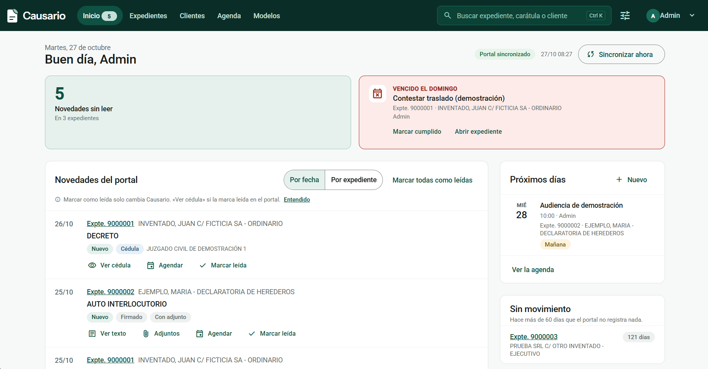
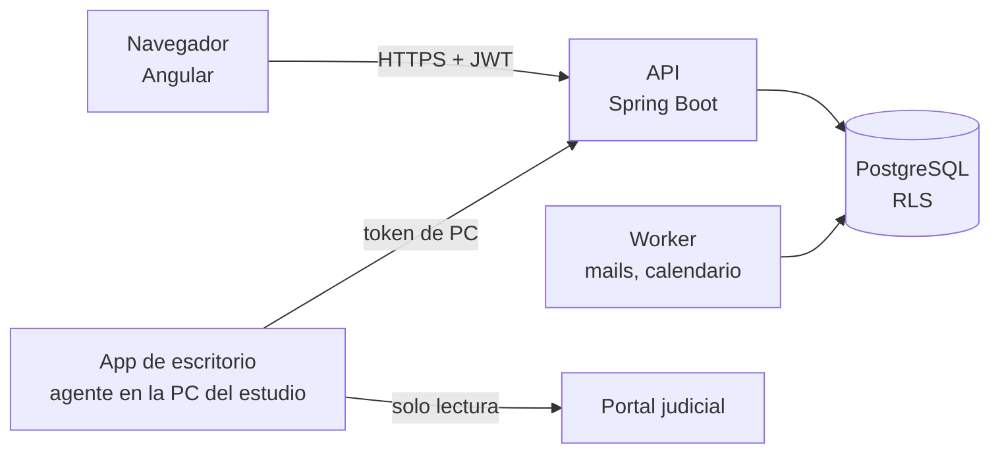

# Causario

Sistema de gestión para estudios jurídicos chicos (1 a 5 personas) que trae solo las novedades de los portales judiciales.

[English version](README.en.md)

## Enlaces

**[Demo en vivo](https://francoamarilla.github.io/causario-demo/)** · [Contacto](#contacto)

## El problema

Un estudio chico suele trabajar con carpetas de Drive y planillas de Excel. Para saber si una causa tuvo novedades, alguien tiene que entrar al portal del Poder Judicial, revisar expediente por expediente y abrir las cédulas. Los vencimientos viven en otra planilla, aparte de lo que pasa en el portal. Si nadie revisa a tiempo, se pierde un plazo.

## Qué hace

| Funcionalidad | Beneficio |
|---|---|
| Sincronización con la Extranet del Poder Judicial de Córdoba (solo lectura) | Las operaciones y cédulas nuevas llegan solas; nadie entra al portal a revisar. |
| Inicio con novedades, vencimientos de la semana y causas sin movimiento | Se ve en una pantalla qué requiere atención hoy. |
| Agenda de vencimientos, audiencias y tareas | Cálculo del plazo en días hábiles según el calendario judicial de cada sede. |
| Aviso diario por mail | Cada persona recibe lo suyo: sus vencimientos y las novedades de sus causas. |
| Expedientes, clientes y partes | Todo en un lugar, con el vínculo entre causa y cliente. |
| Línea de tiempo del expediente | Operaciones del portal y movimientos internos del estudio juntos. |
| Documentos y modelos de escritos | Escritos con datos del expediente completados automáticamente, con exportación a Word. |
| Permisos por persona | El estudio decide quién ve todo y quién ve solo lo suyo. |

Detalle por pantalla en [docs/funcionalidades.md](docs/funcionalidades.md).

## Estado del proyecto

- Primer commit del repositorio: 30/09/2026.
- Piloto en producción desde el 13/10/2026, con 3 personas de un estudio jurídico de Córdoba.
- Integración con Córdoba funcionando. La integración con el PJN está en el roadmap y todavía no está implementada.
- Desarrollado en solitario.

## Stack

| Capa | Tecnología |
|---|---|
| Backend | Java 21, Spring Boot 3.5, Spring Security + JWT, Spring Data JPA (Hibernate 6) |
| Base de datos | PostgreSQL 16, migraciones con Flyway, Row Level Security |
| Frontend | Angular 22 (componentes standalone), Angular Material, TypeScript |
| Integración con portales | Agente en Java; Playwright solo para el login, cliente HTTP para las consultas |
| App de escritorio | Electron (Windows), instalador con actualización automática |
| Tests | JUnit 5, Testcontainers, WireMock, GreenMail, Vitest |
| Despliegue | Docker, Coolify, nginx, backups cifrados |

## Arquitectura

Más detalle en [docs/arquitectura.md](docs/arquitectura.md).

## Decisiones técnicas destacadas

- **Aislamiento entre estudios en la base**, con Row Level Security y claves foráneas compuestas, además del filtro de la aplicación.
- **El portal lo consultan las PCs del estudio**, con su propia IP, y la nube nunca toca el portal.
- **Solo lectura y lista blanca de endpoints**: no se presenta nada y no se evade ningún captcha.
- **Los ids del portal cambian cada día**, así que las novedades se deduplican por número de expediente y de operación.

Todas, con contexto y alternativas, en [docs/decisiones.md](docs/decisiones.md).

## Mi rol

Hice todo el proyecto en solitario:

- Relevamiento con la abogada del estudio piloto y definición de las funcionalidades.
- Diseño de la arquitectura y del modelo de datos.
- Backend, frontend y app de escritorio.
- Instalación, despliegue y soporte del piloto.

Usé IA como asistente de desarrollo. Las decisiones de producto y de arquitectura son mías.

## Código fuente

El repositorio del código es privado porque el producto se va a comercializar. Puedo mostrarlo y recorrerlo en una entrevista.

## Contacto

- GitHub: https://github.com/francoamarilla
- LinkedIn: https://www.linkedin.com/in/franco-maximiliano-amarilla/
- Mail: franco24amarilla@gmail.com
