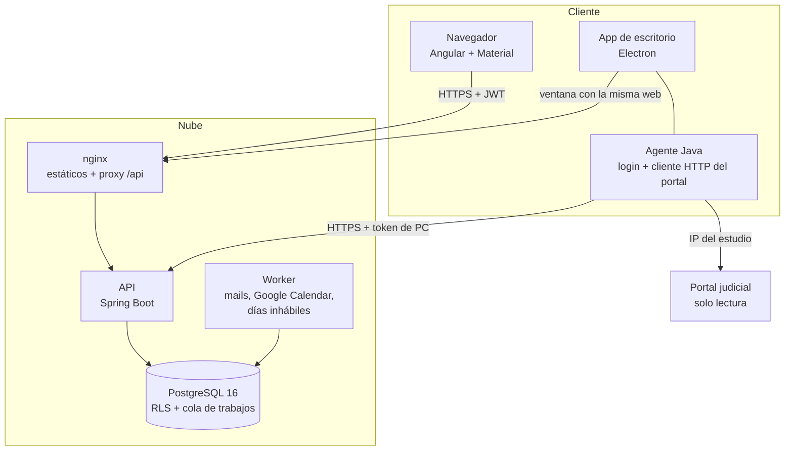
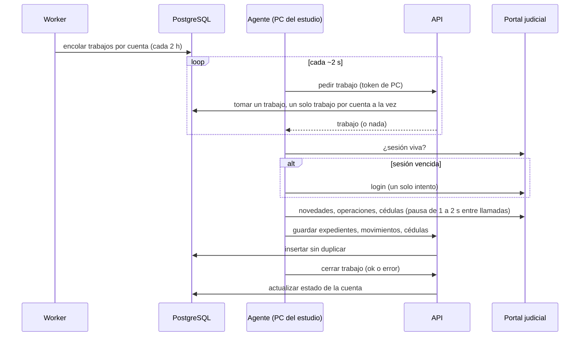
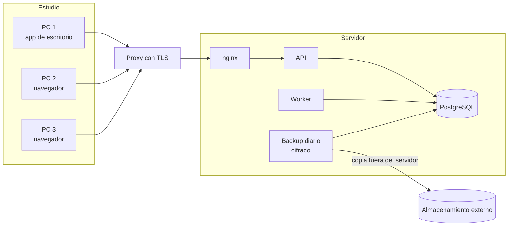

# Arquitectura

## Componentes

Tres procesos separados. Si una PC está apagada o el portal cambia, la aplicación sigue funcionando; solo faltan novedades nuevas.

- **API:** autenticación, ABM, permisos y la API que usan las PCs. Es el único proceso que corre las migraciones.
- **Worker:** encola sincronizaciones, manda mails, sincroniza Google Calendar y el calendario de días inhábiles. No toca el portal.
- **Agente:** corre en las PCs del estudio. Hace el login, mantiene la sesión en memoria y consulta el portal. No tiene acceso a la base: todo pasa por la API con un token revocable.
- **Cola:** es una tabla de Postgres, sin broker de mensajes. Es suficiente para el volumen de estudios chicos.

## Capas de aislamiento entre estudios

1. Filtro por estudio en la capa de persistencia (discriminador de Hibernate).
2. Claves foráneas compuestas (`id`, `estudio_id`), para que un dato no pueda vincularse a otro estudio.
3. Row Level Security en PostgreSQL: la aplicación se conecta con un rol que no es dueño de las tablas, así que la base filtra aunque una consulta se olvide del filtro.

El estudio sale siempre del JWT validado en el servidor, nunca de un parámetro del request.

## Sincronización de causas

Si el trabajo no avisa que sigue vivo (por ejemplo, la PC se suspendió), la nube lo devuelve a la cola y lo toma otra PC.

## Despliegue

- **Nube:** `docker-compose` con cuatro servicios (base, API, worker, nginx) y un servicio de backup. Solo nginx recibe tráfico de afuera, detrás del proxy que termina TLS. La base y la API quedan en la red interna.
- **Estudio:** cada PC instala la app de escritorio (instalador de Windows con actualización automática) y la vincula con su cuenta mediante un token que se muestra una sola vez.

