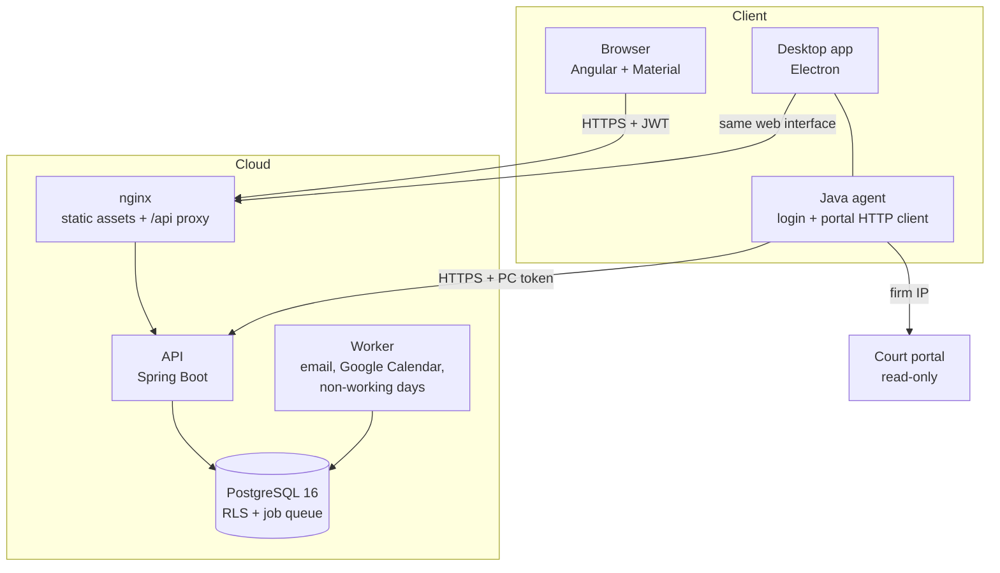
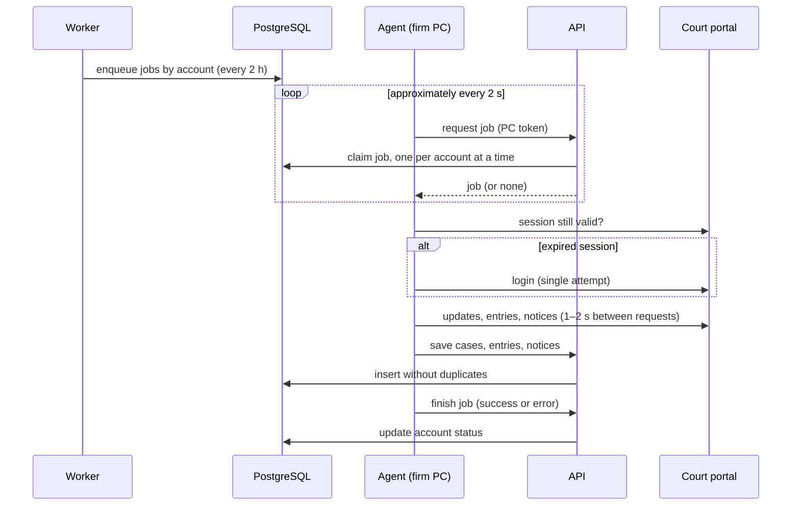
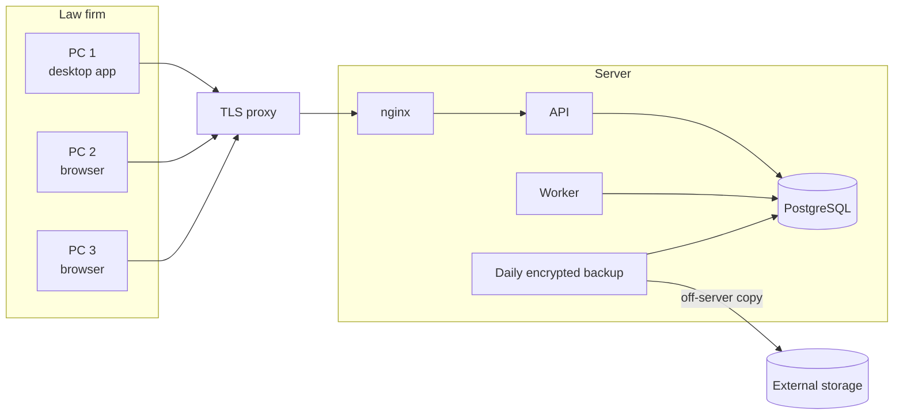

# Architecture

[Versión en español](../arquitectura.md)

## Components

Three separate processes. If a PC is turned off or the portal changes, the application continues to work; only new portal updates are unavailable.

- **API:** authentication, CRUD operations, permissions and endpoints used by the PCs. It is the only process that runs migrations.
- **Worker:** queues synchronization jobs, sends emails, synchronizes Google Calendar and the non-working-day calendar. It does not access the court portal.
- **Agent:** runs on the firm's PCs. It logs in, keeps the session in memory and queries the portal. It has no database access: everything goes through the API using a revocable token.
- **Queue:** a PostgreSQL table rather than a message broker, sufficient for the workload of small law firms.

## Tenant isolation layers

1. Tenant filtering in the persistence layer (Hibernate discriminator).
2. Composite foreign keys (`id`, `estudio_id`), preventing data from being linked to another firm.
3. PostgreSQL Row-Level Security: the application connects using a role that does not own the tables, so the database enforces filtering even if a query omits the application filter.

The tenant is always obtained from the JWT validated on the server, never from a request parameter.

## Case synchronization

If a job stops reporting its heartbeat (for example, because the PC goes to sleep), the cloud returns it to the queue so another PC can claim it.

## Deployment

- **Cloud:** Docker Compose with four services (database, API, worker, nginx) and a backup service. Only nginx receives external traffic, behind the TLS-terminating proxy. The database and API remain on the internal network.
- **Law firm:** each PC installs the desktop app (Windows installer with automatic updates) and links it to its account using a token displayed only once.

See also [Technical decisions](technical-decisions.md) and [CI/CD](ci-cd.md).
