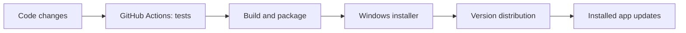

# CI/CD and desktop application distribution

[Versión en español](../ci-cd.md)

## Goal

Automate code validation and the distribution of new Causario versions, reducing the manual work required to maintain law firm installations.

## Overview

- **Continuous integration:** GitHub Actions runs automated tests.
- **Build and packaging:** Windows installers are generated for the Electron desktop application.
- **Distribution:** the installed application includes an automatic update mechanism to receive new versions.

The diagram illustrates the conceptual validation and distribution process, not the exact workflow configuration.

## Scope

The public documentation describes CI/CD capabilities, installers and automatic updates. Workflow definitions, triggers, publishing conditions, artifact management and updater configuration belong to the private source repository and are not detailed here.

For the system components and deployment overview, see [Architecture](architecture.md).
