# Features

[Versión en español](../funcionalidades.md)

A walkthrough of the application screens using fictional data.

## Home

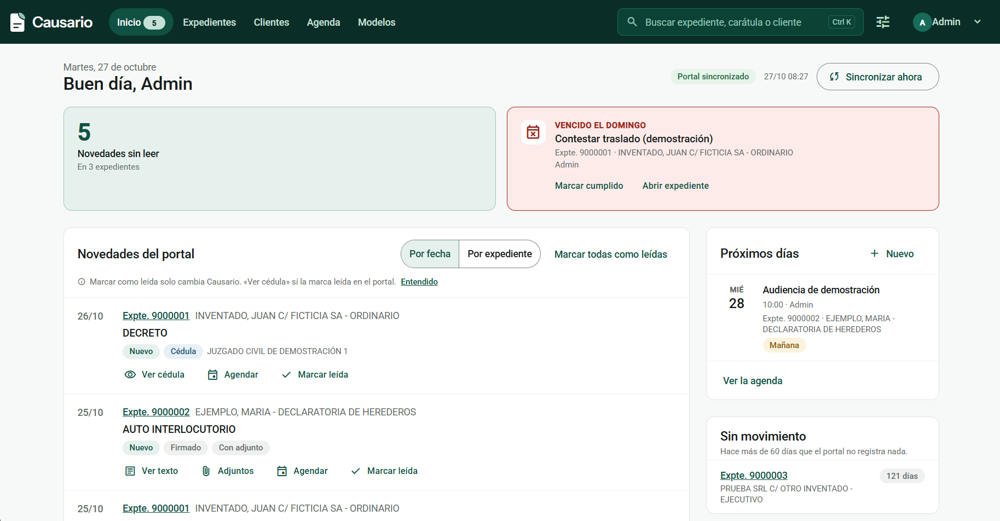

The “Important today” area displays unread updates and overdue or due-today deadlines. Below it are portal updates (by date or case), upcoming days and inactive cases. Marking an entry as read or completed can be undone; “Sync now” requests a synchronization.

## Cases

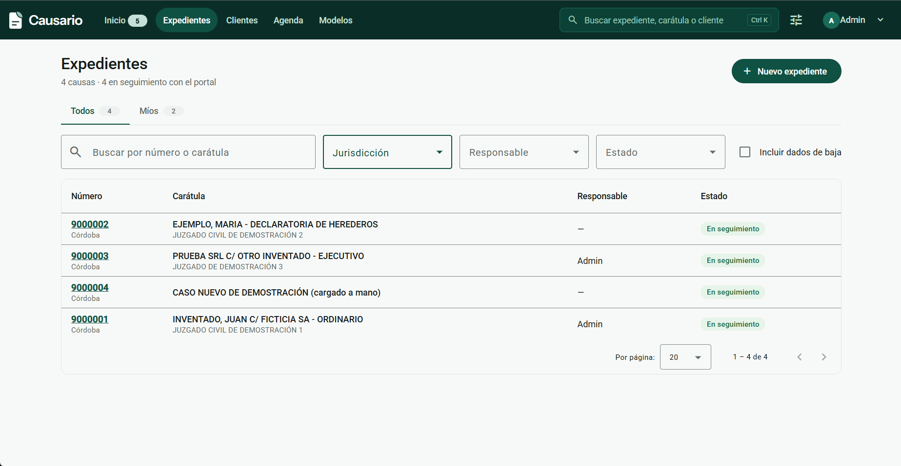

All and My Cases tabs, search and filters. Case numbers and titles link to the details page. Each case has an assigned person and a link to its Drive folder.

## Case details

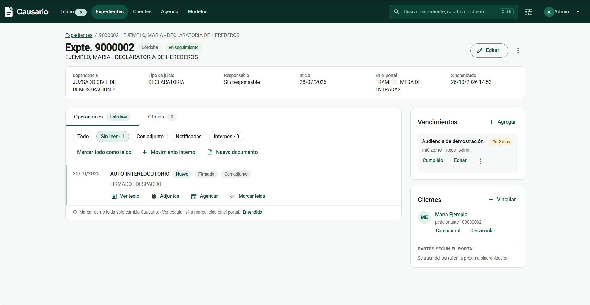

Combines court portal entries and internal firm entries in a filterable timeline. Shows parties, linked clients, deadlines and official correspondence.

## Text, notices and attachments

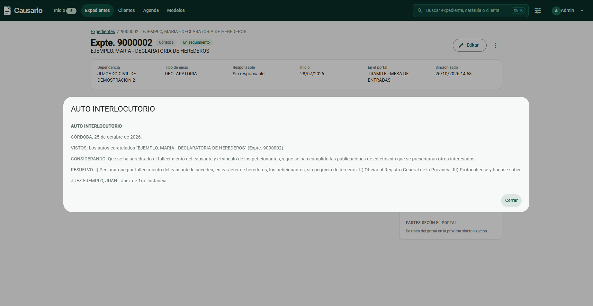

Displays entry text and attachments on demand. Notices are opened only at a person's request because opening them marks them as read on the portal.

## Calendar

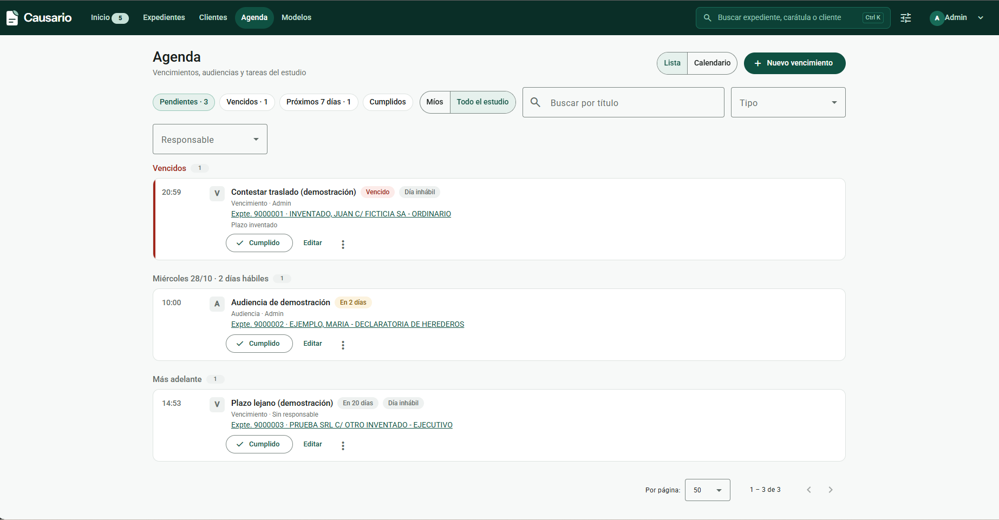
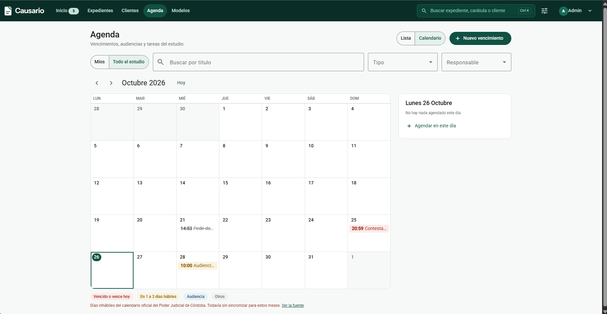

Deadlines, hearings and tasks in a date-grouped list or monthly calendar, with My / Entire Firm filters. Completion can be undone. Business-day calculations use the judicial calendar of the case's court.

## Creating an event

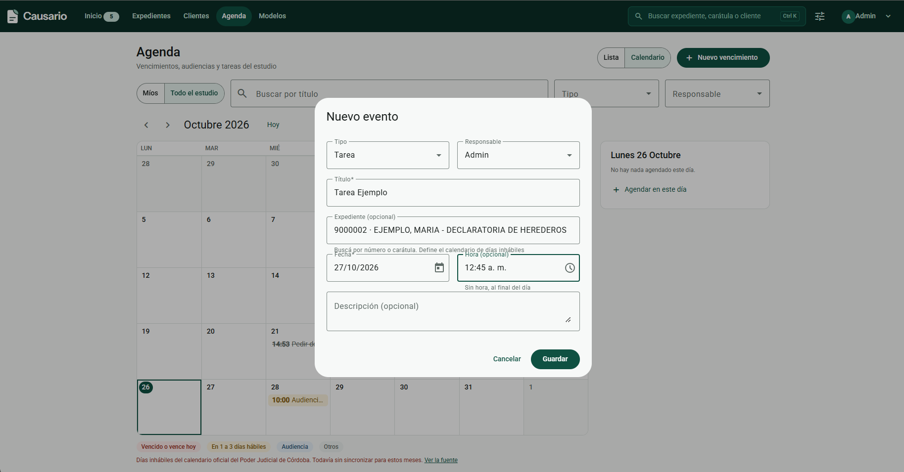

The form changes according to the event type: task, hearing or deadline. Deadline dates are calculated from the notification date and specified business days, and can be manually corrected. Events can be scheduled directly from a notice or entry.

## Clients

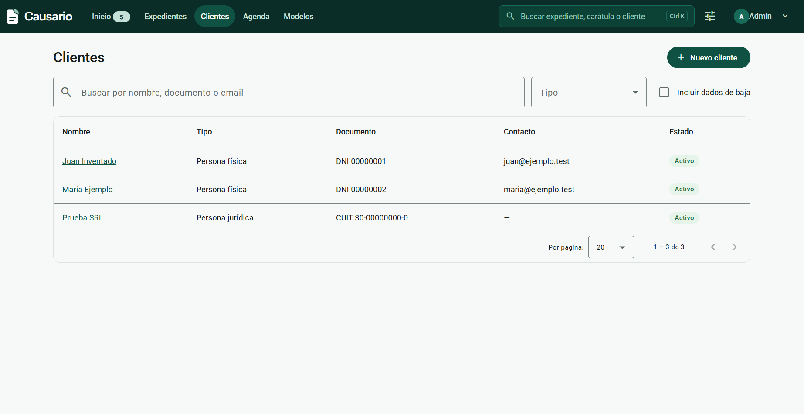

Client CRUD and search. A client can be created or linked from a party listed on the portal, with user confirmation.

## Legal document templates

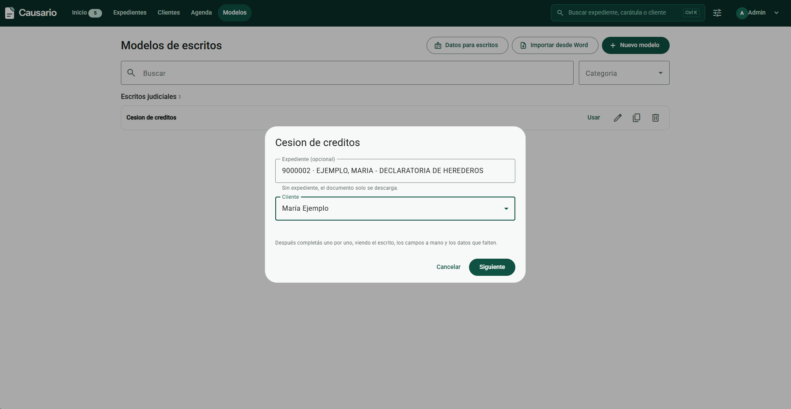

Template library organized by category, with Word import. Case, client and lawyer details are filled automatically.

## Completing a template

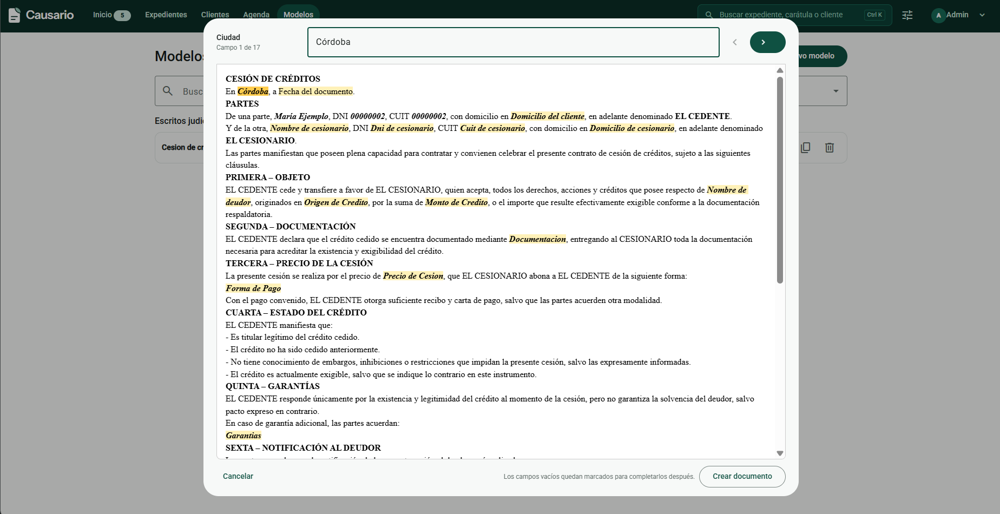

https://github.com/user-attachments/assets/854582ce-538b-42af-9958-297f768c571f

Manual fields are filled one at a time while viewing the document. Missing fields are highlighted in red. The result can be stored as a case document or downloaded in Word format.

## Portal accounts and synchronization PCs

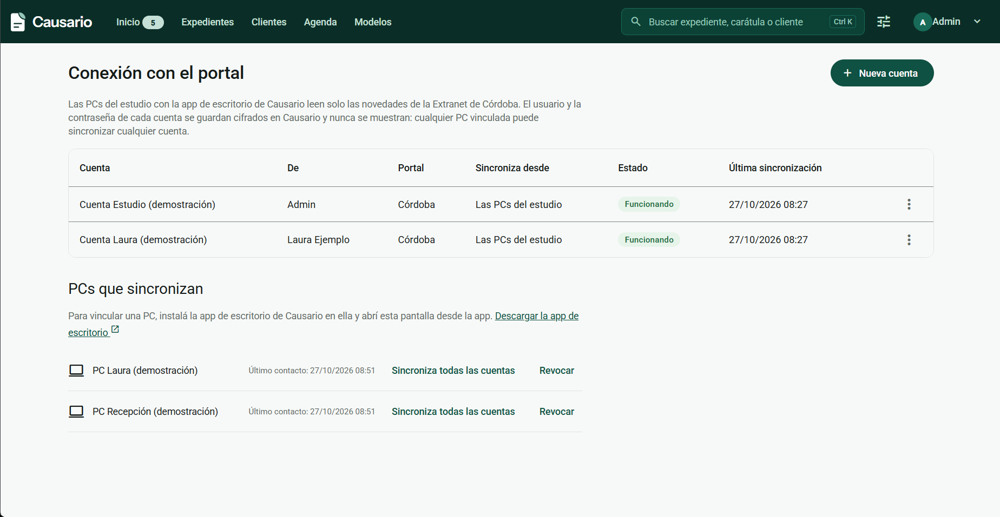

Shows the status of each portal account and linked PC. Users can register credentials (never displayed), revoke a PC and choose which accounts each PC synchronizes.

## Users and visibility

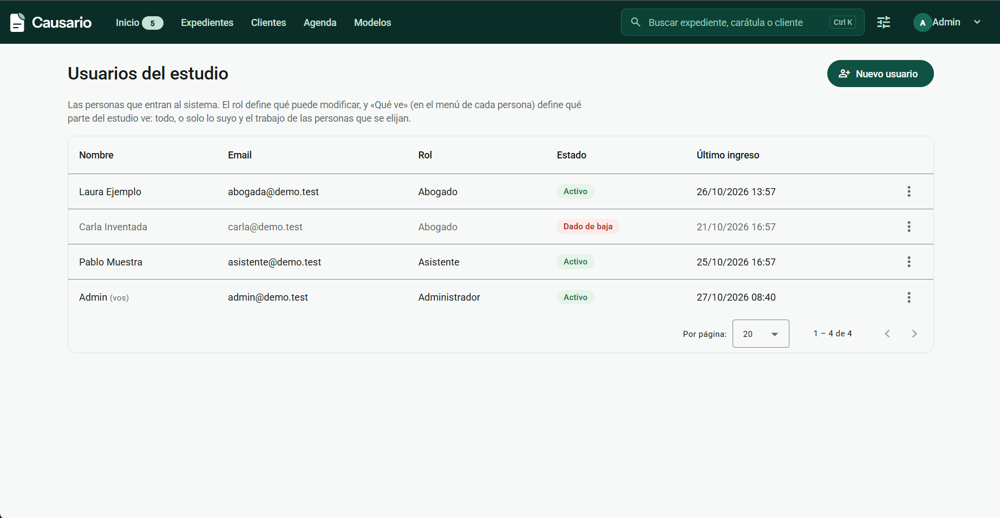

User creation and removal with three roles. The administrator determines whether each person can view the entire firm's records or only their own.
