# Funcionalidades

Recorrido por las pantallas, con datos ficticios.

## Inicio
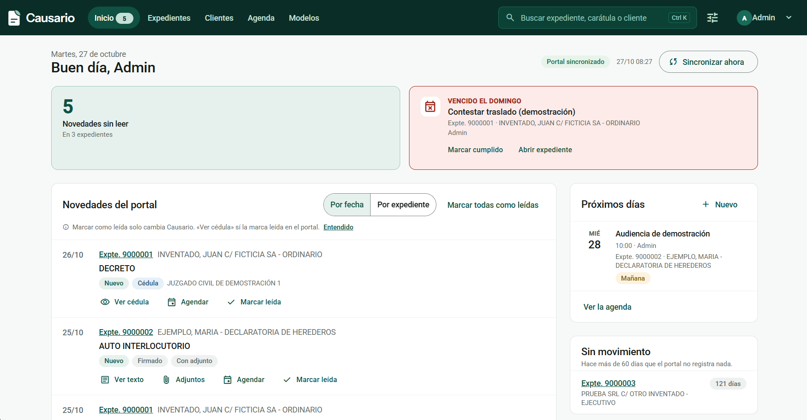

En "Lo importante hoy" muestra las novedades sin leer y los vencimientos vencidos o que vencen hoy. Debajo, las novedades del portal (por fecha o por expediente), los próximos días y las causas sin movimiento. Marcar como leída o cumplida se puede deshacer, y "Sincronizar ahora" pide una sincronización.

## Expedientes
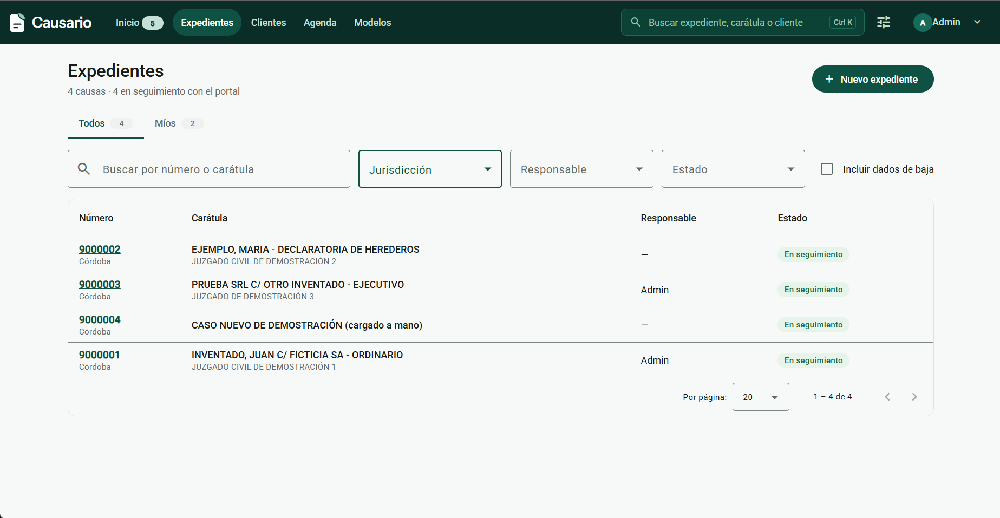

Listado con pestañas "Todos" y "Míos", con búsqueda y filtros. Número y carátula son enlaces al detalle. Cada expediente tiene responsable y enlace a su carpeta de Drive.

## Detalle del expediente
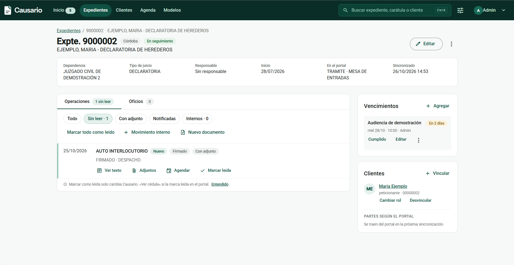

Reúne las operaciones del portal y los movimientos internos del estudio en una sola línea de tiempo, con filtros. Muestra las partes, los clientes vinculados, los vencimientos y los oficios.

## Texto, cédulas y adjuntos
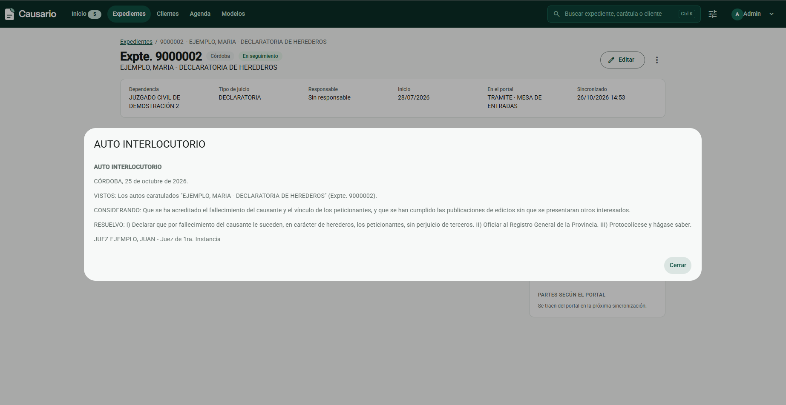

Permite ver el texto de una operación y sus adjuntos bajo demanda. Las cédulas se abren solo cuando una persona lo pide, porque en el portal eso las marca como leídas.

## Agenda
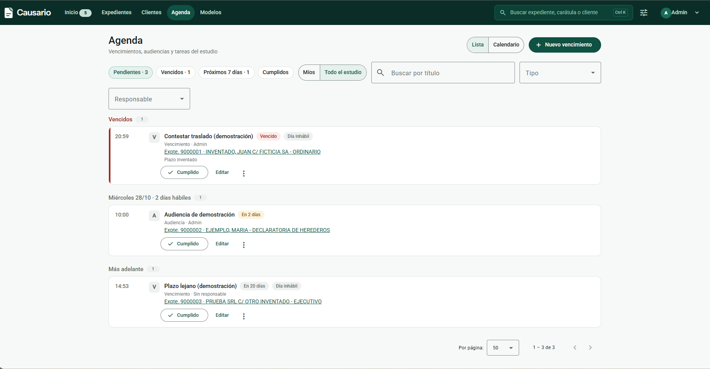
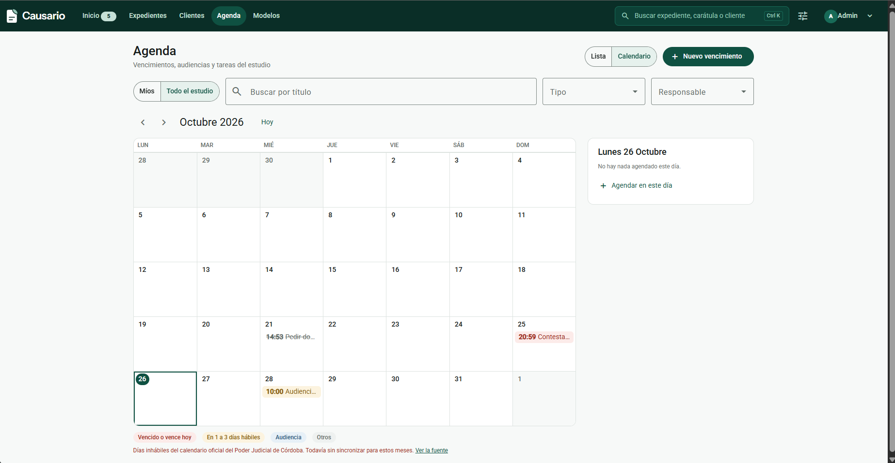

Vencimientos, audiencias y tareas, en lista agrupada por fecha o en calendario mensual, con filtro "Míos / Todo el estudio". "Cumplido" se puede deshacer. Los días hábiles se calculan con el calendario judicial de la sede del expediente.

## Alta de un evento
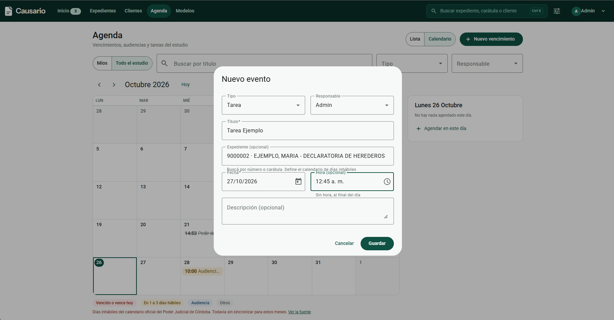

El alta cambia según el tipo: tarea, audiencia o vencimiento. En un vencimiento, el plazo se calcula desde la fecha de notificación y los días hábiles indicados; la persona puede corregir la fecha final. Se puede agendar directamente desde una cédula o una operación.

## Clientes
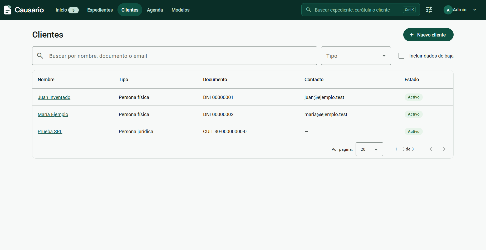

ABM de clientes con búsqueda. Desde las partes del portal se puede crear o vincular un cliente, siempre con confirmación de la persona.

## Modelos de escritos
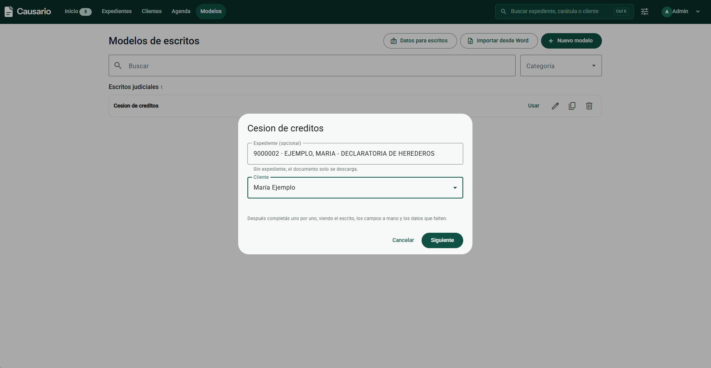

Biblioteca de modelos del estudio por categoría, con importación desde Word. Los datos del expediente, cliente y abogado se completan solos.

## Completar un modelo

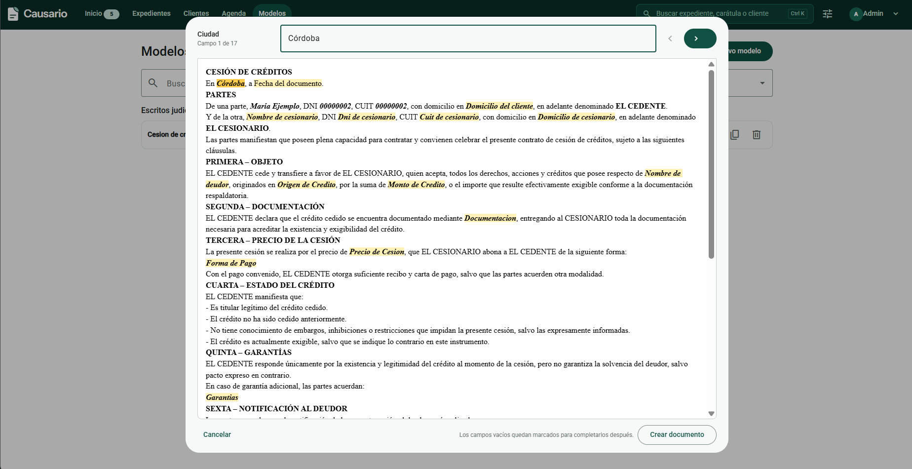

[Ver el recorrido en video](../assets/capturas/completar-modelo.mp4).

Los campos a mano se completan uno por uno viendo el escrito. Lo que falta queda marcado en rojo. El resultado se guarda como documento del expediente o se descarga en Word.

## Portal y PCs que sincronizan
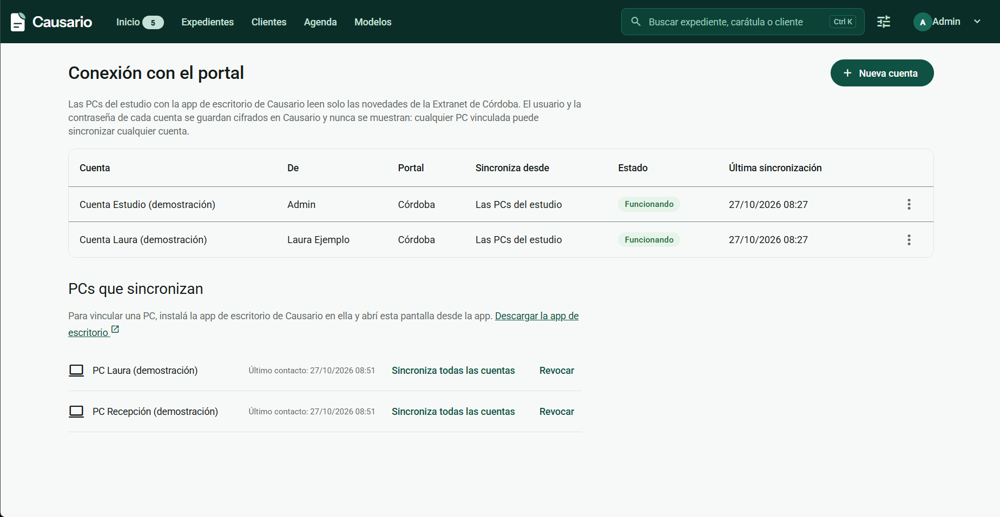

Estado de cada cuenta del portal y de las PCs vinculadas. Se pueden cargar credenciales (nunca se muestran), revocar una PC y elegir qué cuentas sincroniza cada una.

## Usuarios y visibilidad
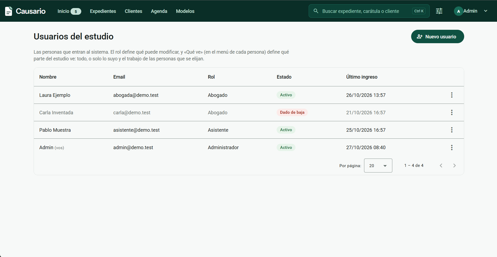

Alta y baja de usuarios con tres roles. La administradora decide si cada persona ve todo el estudio o solo lo suyo.
